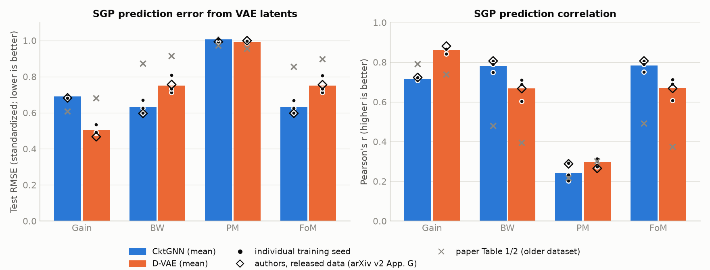
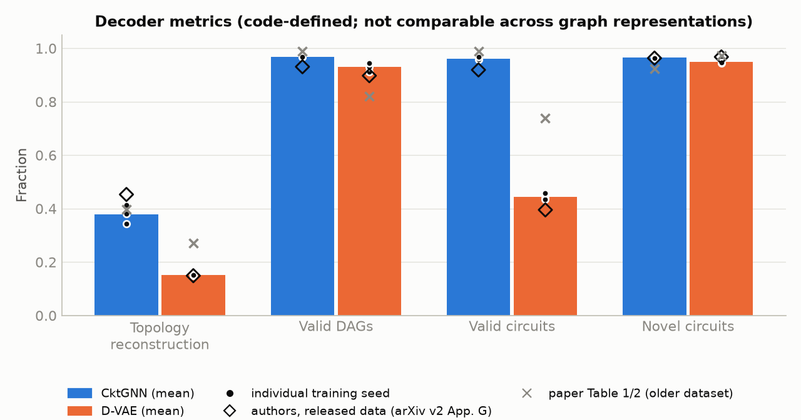
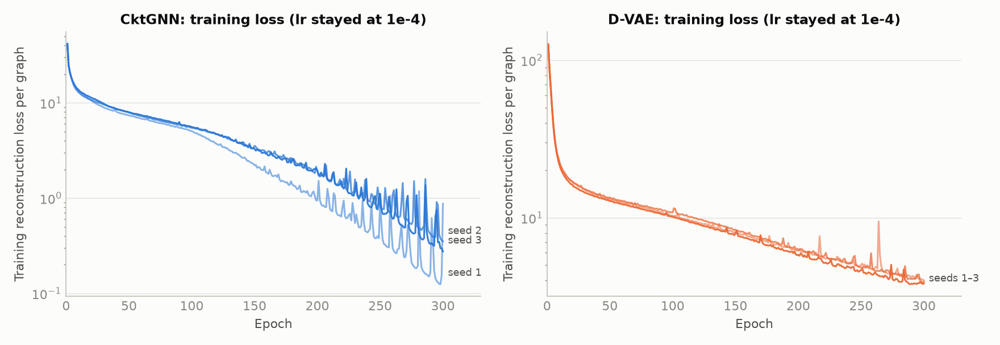

# CktGNN replication — Phase 2: baseline reproduction results

**Date:** 2026-10-14. **Scope:** VAE training and evaluation of **CktGNN** and **D-VAE** on the released Ckt-Bench-101 (paper Tables 1–2 / arXiv v2 Appendix G Tables 3–4), with **3 training seeds each**. No model was modified.
**Data and logs:** `D:\CktGNN_data\results\vae\<MODEL>_seed<k>\`. **Summary files:** `D:\CktGNN_data\results\summary\` (`per_run.csv`, `reproduction_table.csv/.md`, `significance.csv`). **Figures:** [`reports/figures/`](figures/).
Evidence tags follow the Phase 1 report: **[E]** measured here, **[P]** paper, **[C]** code.

---

## 1. Headline results

1. **The released-data results are reproduced.** [E] Across 3 seeds, every SGP regression metric (RMSE and Pearson r for gain, BW, PM and FoM) lands within 0.046 of the authors' own numbers for the released dataset (arXiv v2 App. G). D-VAE's reconstruction accuracy matches almost exactly (0.151 vs 0.149). Most decoder metrics are within 0.05.
2. **The paper's Table 1 is not reproducible on the released data, as expected.** The dataset changed after publication. On the released data, CktGNN's BW/FoM prediction is much better than the paper reports (FoM RMSE 0.63 vs 0.854), and D-VAE's gain prediction is much better (0.50 vs 0.681).
3. **"CktGNN consistently achieves state-of-the-art predictive performance" [P §5.2] is not supported.** [E]
   - **D-VAE is significantly better on gain:** RMSE 0.504 vs 0.690, Welch p = 0.004; r 0.859 vs 0.715, p = 0.001.
   - **CktGNN is better on BW and FoM:** RMSE 0.631 vs 0.751, p ≈ 0.03. These are effectively one target, since FoM ≈ 10·BW (Phase 1 audit, r = 0.9996).
   - **Neither model predicts PM** (r ≈ 0.24–0.30; difference not significant).
4. **The paper's error bars understate the real variance by about 5–20×.** [E][C] The ± in Table 1 comes from re-seeding the regression on one trained model. Our 9 regression folds per model reproduce that small spread (std 0.001–0.002), but retraining with different seeds gives std 0.008–0.05 on the same metrics. CktGNN's reconstruction accuracy varies 0.344–0.413 across seeds (std 0.034).
5. **CktGNN's decoder metrics are higher, but the comparison is not like-for-like.** [E][C] Reconstruction is 0.379 vs 0.151 and "valid circuits" 96% vs 44%. The two models are scored on different graph formats with different validity rules (Phase 1 §6.3): a ≤8-node subgraph DAG with a slot check versus a ≤16-node device DAG with a diameter-path check. A circuit-level check is needed (§6).
6. **Neither model had converged after 300 epochs.** [E] Training losses were still falling, and `ReduceLROnPlateau` never lowered the learning rate during training: the rate stayed at 1e-4 for every run, and only D-VAE seed 3 dropped at its final scheduler step. So the README's patience 10 versus the paper's 20 made no difference, but 300 versus 200 epochs would.
7. **CktGNN memorizes training topologies.** [E] Its training reconstruction loss ends at 0.15–0.39 per graph against a test NLL of 4.9–6.9, a gap of about 15–30×. D-VAE's gap is about 3× (3.8–4.1 train vs 12.8–13.7 test).
8. **A plain supervised model still predicts better than any latent-space regressor.** [E] The random forest from the Phase 1 audit gets FoM RMSE 0.451 vs 0.631 (CktGNN) and 0.750 (D-VAE), and gain 0.315 vs 0.504/0.690. The paper's protocol measures how smooth the unsupervised latent space is, not the best achievable accuracy, and should be reported that way.

---

## 2. Protocol

| Item | Setting | Source |
|---|---|---|
| Data | Released Ckt-Bench-101; first 9,000 train, last 1,000 test | [C] `utils.py:421` |
| Models | Authors' `CktGNN` (hs 301, nz 66, emb 24/8, slot prior on) and `DVAE` (hs 301, nz 66) from `layers/models_ig.py` | [C] |
| Training | Adam lr 1e-4, batch 64, KL weight 0.005, `ReduceLROnPlateau(0.1, patience 10)`, **300 epochs** (README setting) | [C] `main.py` |
| Seeds | 1, 2, 3 (torch / numpy / python RNGs) | — |
| Decoder metrics | Authors' protocol: 1000 test graphs × 10 × 10 decodes for reconstruction; 1000 prior points × 10 decodes, rescaled to the training-latent mean/std, for validity and novelty | [C] `main.py:test`, `utils.prior_validity` |
| Latent regression | Authors' SGP protocol: negated, standardized targets; M = 500 inducing points; Adam lr 5e-4; 100 epochs; minibatch 1000; 9 folds (SGP seeds 1–9) per trained model | [C] `sgp_regression.py` |
| Hardware | RTX 3050 6 GB laptop GPU for training (three runs side by side); i5-12450HX CPU for evaluation and regression | — |
| Runtime per seed | CktGNN: 1.6–1.8 h training (19–22 s/epoch) + 9–13 min evaluation. D-VAE: 4.1–4.3 h training (46–50 s/epoch) + 20–41 min evaluation. About 1 h of regression per run | [E] |

### Deviations from the original setup (all documented)

| # | Deviation | Why | Effect on results |
|---|---|---|---|
| 1 | Training uses `scripts/fast_models.py`, which batches the authors' `encode`/`loss` over the 64 graphs | 5–9× faster; the original needed ~22 h per D-VAE seed | None expected: same parameters and equations. `tests/test_fast_models.py` shows identical losses (rel. err ≤ 4e-7) and gradients equal to float32 rounding |
| 2 | Regression uses a PyTorch float64 port of the Theano sparse GP (`scripts/sparse_gp_torch.py`) | Theano does not install on Python 3.13 | Validated: regression results match the authors' published released-data numbers (§3) |
| 3 | Novelty uses an exact hash of what `is_same_DAG` compares | The original O(N·M) scan is slow | None: identical on 3,200 test pairs |
| 4 | Training on GPU, evaluation on CPU | The authors' per-graph decoder is about 15× slower on GPU | GPU and CPU draw different random numbers (reparameterization noise, sampling); distributions are unchanged |
| 5 | Released Ckt-Bench-101 instead of the paper's dataset | The paper's dataset is not public | Paper Table 1 numbers are not expected to match; the released-data numbers are the target |
| 6 | 300 epochs, patience 10 (README) rather than 200, patience 20 (paper App. E) | Follows the released code | Patience was irrelevant (no LR decay); epoch count matters (§5) |

---

## 3. Comparison with the published numbers

Reproduced values are the mean ± std over 3 training seeds. "Δ" is reproduced minus the authors' released-data value; "rel." is Δ divided by that value.

### CktGNN
| Metric | Paper (old data) | Authors, released data | **Reproduced** | Δ | rel. | Explanation |
|---|---:|---:|---:|---:|---:|---|
| Gain RMSE / r | 0.607 / 0.791 | 0.682 / 0.723 | **0.690 ± 0.008 / 0.714 ± 0.007** | +0.008 / −0.009 | +1% / −1% | Reproduced |
| BW RMSE / r | 0.873 / 0.479 | 0.596 / 0.806 | **0.631 ± 0.036 / 0.781 ± 0.029** | +0.035 / −0.025 | +6% / −3% | Within ~1 seed std |
| PM RMSE / r | 0.973 / 0.217 | 0.993 / 0.288 | **1.006 ± 0.011 / 0.242 ± 0.046** | +0.013 / −0.046 | +1% / −16% | r near chance either way; within 1 seed std |
| FoM RMSE / r | 0.854 / 0.491 | 0.597 / 0.806 | **0.631 ± 0.035 / 0.782 ± 0.028** | +0.034 / −0.024 | +6% / −3% | Tracks BW (FoM ≈ 10·BW) |
| Topology reconstruction | 0.397 | 0.453 | **0.379 ± 0.034** | −0.074 | −16% | The authors' value is about 2 seed-std above our mean (one lucky seed, or a different epoch count) |
| Valid DAGs | 98.92% | 93.10% | **96.8 ± 0.1%** | +3.7 pt | +4% | Between the two published values |
| Valid circuits | 98.92% | 91.92% | **96.2 ± 0.6%** | +4.2 pt | +5% | Code-defined validity (no simulation) |
| Novel circuits | 92.29% | 96.34% | **96.6 ± 0.4%** | +0.3 pt | 0% | Reproduced |

### D-VAE
| Metric | Paper (old data) | Authors, released data | **Reproduced** | Δ | rel. | Explanation |
|---|---:|---:|---:|---:|---:|---|
| Gain RMSE / r | 0.681 / 0.739 | 0.467 / 0.881 | **0.504 ± 0.026 / 0.859 ± 0.016** | +0.037 / −0.022 | +8% / −2% | Within ~1.5 seed std |
| BW RMSE / r | 0.914 / 0.394 | 0.756 / 0.667 | **0.751 ± 0.050 / 0.668 ± 0.056** | −0.005 / +0.001 | −1% / 0% | Reproduced |
| PM RMSE / r | 0.956 / 0.301 | 0.999 / 0.265 | **0.991 ± 0.006 / 0.297 ± 0.021** | −0.008 / +0.032 | −1% / +12% | Reproduced |
| FoM RMSE / r | 0.897 / 0.374 | 0.755 / 0.668 | **0.750 ± 0.049 / 0.670 ± 0.056** | −0.005 / +0.002 | −1% / 0% | Reproduced |
| Topology reconstruction | 0.271 | 0.149 | **0.151 ± 0.002** | +0.002 | +1% | Reproduced |
| Valid DAGs | 82.12% | 89.75% | **93.0 ± 1.6%** | +3.2 pt | +4% | |
| Valid circuits | 73.93% | 39.53% | **44.4 ± 1.3%** | +4.9 pt | +12% | Code-defined validity (no simulation) |
| Novel circuits | 97.15% | 96.78% | **94.9 ± 0.8%** | −1.8 pt | −2% | |

**Reproduction status:** *approximately reproduced* for the released data, for every metric of both models except CktGNN reconstruction accuracy, which is lower by about 2 seed std. *Not reproducible* for the paper's Table 1/2 values, because the dataset they were computed on is not public.

---

## 4. Figures


*Figure 1. Regression from the learned latent space (lower RMSE and higher r are better). Bars are means over 3 training seeds; dots are individual seeds; hollow diamonds are the authors' released-data results; grey crosses are the paper's Table 1 (older dataset).*


*Figure 2. Decoder metrics as defined in the authors' code. The two models are scored on different graph formats and validity rules, so cross-model gaps (especially "valid circuits") are not like-for-like.*


*Figure 3. Training reconstruction loss per graph (log scale). Losses are still falling at epoch 300 and the learning rate never decayed. CktGNN shows large periodic spikes and drives its training loss far below its test NLL.*

---

## 5. Statistical comparison: CktGNN vs D-VAE

Welch's t-test across training seeds (3 vs 3). With n = 3 the tests have low power, so p-values near 0.05 should be read as suggestive.

| Metric | CktGNN | D-VAE | Difference | p | Better |
|---|---:|---:|---:|---:|---|
| Gain RMSE | 0.690 ± 0.008 | 0.504 ± 0.026 | +0.187 | **0.004** | D-VAE |
| Gain r | 0.715 ± 0.007 | 0.859 ± 0.016 | −0.145 | **0.001** | D-VAE |
| BW RMSE | 0.631 ± 0.036 | 0.751 ± 0.050 | −0.120 | **0.031** | CktGNN |
| BW r | 0.781 ± 0.029 | 0.668 ± 0.056 | +0.114 | 0.054 | CktGNN (suggestive) |
| PM RMSE | 1.006 ± 0.011 | 0.991 ± 0.006 | +0.015 | 0.135 | — |
| PM r | 0.242 ± 0.046 | 0.297 ± 0.021 | −0.055 | 0.163 | — |
| FoM RMSE | 0.631 ± 0.035 | 0.750 ± 0.049 | −0.119 | **0.031** | CktGNN |
| FoM r | 0.782 ± 0.028 | 0.670 ± 0.056 | +0.113 | 0.053 | CktGNN (suggestive) |
| Reconstruction | 0.379 ± 0.034 | 0.151 ± 0.002 | +0.229 | **0.007** | CktGNN* |
| Valid DAGs | 96.8 ± 0.1% | 93.0 ± 1.6% | +3.9 pt | 0.055 | CktGNN* (suggestive) |
| Valid circuits | 96.2 ± 0.6% | 44.4 ± 1.3% | +51.7 pt | **<0.001** | CktGNN* |
| Novel circuits | 96.6 ± 0.4% | 94.9 ± 0.8% | +1.7 pt | **0.044** | CktGNN* |

\* Different graph formats and validity rules; see headline 5.

---

## 6. Interpretation

- **What reproduced:** the authors' *released-data* claims, closely (§3). The training code, the batched training path, and the regression port together reproduce the released-data results.
- **What did not:** the paper's narrative that CktGNN wins prediction across the board. On the released data it is one significant win (BW ≈ FoM), one significant loss (gain), and no difference on PM. The authors' own App. G Table 3 shows the same pattern, despite its text saying CktGNN "still achieve[s] state-of-the-art".
- **Why the error bars matter:** many of the paper's model differences (0.01–0.04 RMSE) are smaller than the seed-to-seed spread measured here, so Table 1's ranking is not established without retraining several seeds per model.
- **Decoder metrics need a circuit-level definition.** The 96% vs 44% "valid circuit" gap partly reflects the different checks used for each representation and the slot prior that structures CktGNN's decoder. Next step: decode → `ocb_sim.py` → count circuits that simulate and have a unity-gain crossing.
- **Training length is a confound.** Neither model converged, so a longer schedule or a working LR decay could change the ranking. CktGNN's 15–30× train/test reconstruction gap also suggests that regularization (e.g. a non-negligible KL weight; the code's `eps_scale = 0.01` and β = 0.005 make the VAE nearly deterministic) matters for generalization.

## 7. Still to do for a complete Phase 4

| Item | Status | Blocker / plan |
|---|---|---|
| DAGNN baseline | Not run | Needs a PyG 2.x port of `layers/dagnn_pyg.py` (`torch_geometric.nn.glob`, `torch_sparse`) |
| PACE, GCN, GIN, NGNN, Graphormer, Pathformer | Not run | Not in the repo; use the official PACE/NGNN code or drop them from the comparison |
| Paper hyperparameters (200 epochs, patience 20) | Not run | ~1.1 h (CktGNN) / 2.7 h (D-VAE) per seed with the fast path |
| BO (Table 2 / Ckt-Bench-301) | Not run | Needs `pybnn`; the EI implementation should also be corrected (Phase 1 §2.4) |
| Encoding-efficiency timings (Fig. 3) | Partial | Training times for both implementations are available (README table) |
| Circuit-level validity of decoded graphs | Not run | Decoded graphs → `ocb_sim.py` |

## 8. Reproduce this report

```bash
DEVICE=cuda bash scripts/launch_job.sh CktGNN 1 --epochs 300 --patience 10
```
(repeat for seeds 2–3 and for `DVAE`), then
```bash
.venv/Scripts/python.exe scripts/sgp_regression.py --run D:/CktGNN_data/results/vae/CktGNN_seed1
```
for each run, and finally
```bash
.venv/Scripts/python.exe scripts/aggregate_results.py
```
```bash
.venv/Scripts/python.exe scripts/plot_results.py
```
