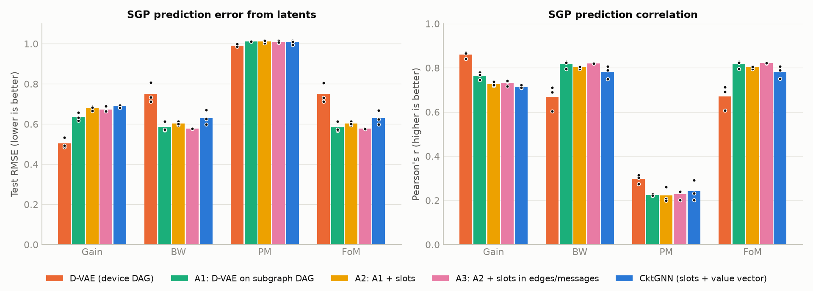
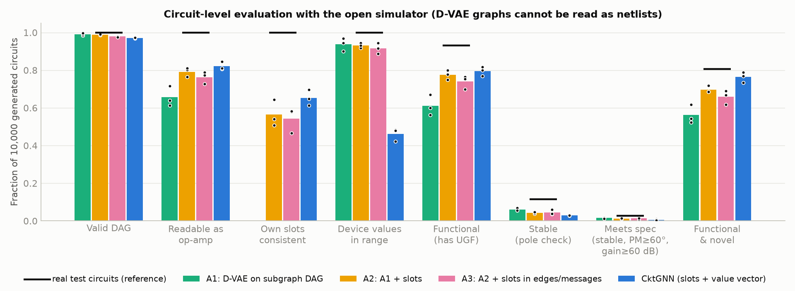
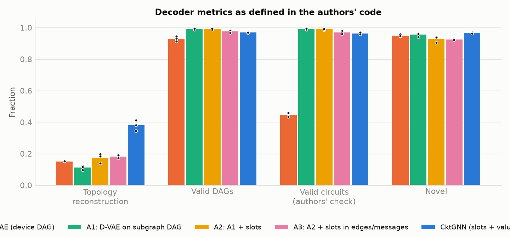

# CktGNN replication — Phase 3: what actually explains CktGNN's results? (ablation study)

**Date:** 2026-10-14. **Question:** CktGNN differs from the D-VAE baseline in three ways at once. Which of them produces its reported advantages?
1. **Representation:** a ≤8-node graph of subgraphs (26 types) instead of a ≤16-node graph of devices.
2. **Slot prior:** a one-hot "position slot" for every node (stage 1/2/3, extra slots). The paper never mentions it [Phase 1, finding 2].
3. **Device-value pathway:** values stored as one slot-indexed 27-vector, encoded by a separate MLP and decoded all at once from z. The paper describes an inner GNN instead, which the code never uses [Phase 1, finding 1].

> **Correction (2026-10-14, after Phase 4):** an earlier version of this report used a phase-margin-only metric ("functional & PM ≥ 45°") as a stability proxy and concluded that CktGNN's generated circuits had better phase margins. Phase 4 added an exact pole-based stability check. That check shows PM is not a valid stability test here, because most OCB circuits are unstable even in open loop. With the pole check, **CktGNN generates the fewest stable circuits** (3.0% vs 6.0% for A1). The affected rows, findings and figure are corrected below.

> **Update (Phase 5, 2026-10-15):** a third variant, **A3** (A2 plus CktGNN's slots in the messages and the edge scorer), separates the bundled last step. **The value pathway alone explains CktGNN's reconstruction advantage (A3 0.181 vs CktGNN 0.379) and its unphysical device values (92% vs 46% in range).** Slot-aware structure decoding changes neither, though it slightly improves latent regression. See `reports/phase5_report.md`, Part A.

**Method:** two new variants isolate one change at a time. Every model was trained with 3 seeds, 300 epochs, the same optimiser and the same losses. All were evaluated with the authors' metrics, the authors' SGP regression protocol, and a new **circuit-level evaluation** that simulates every generated circuit with the open simulator.

| Variant | Graph | Slots | Device values | Parameters |
|---|---|---|---|---:|
| D-VAE (baseline) | device DAG | no | per node (scalar) | 2.24M |
| **A1** `SubgDVAE` | subgraph DAG | no | per node ([r, c, gm]) | 2.28M |
| **A2** `SubgDVAEpos` | subgraph DAG | node input + decoder head | per node | 2.49M |
| **A3** `SubgDVAEslot` (Phase 5) | subgraph DAG | as CktGNN: + messages + edge scorer | per node | 2.51M |
| CktGNN (baseline) | subgraph DAG | node input + decoder head + messages + edge scorer | slot-indexed vector | 2.51M |

A1 and A2 use the authors' D-VAE equations unchanged (`scripts/ablation_models.py`).
**Caveat on the last step:** A2 → CktGNN changes the value pathway *and* adds slots to the messages and to the edge scorer. The tables below keep the original A2 → CktGNN comparison; A3 (Phase 5) separates the two.

---

## 1. Headline findings

1. **CktGNN's latent-space advantage comes entirely from the representation.** Moving D-VAE onto CktGNN's subgraph graph (A1) improves BW/FoM prediction from RMSE 0.750 to **0.584** (p = 0.014). That is *better* than CktGNN itself (0.631). It also costs exactly the gain accuracy that CktGNN loses (0.504 → 0.635, p = 0.003). Adding slots (A2) or CktGNN's value pathway changes none of the regression metrics significantly. The "two-level GNN" adds nothing to the paper's headline metric.
2. **The slot prior improves generation, not representation.** A1 → A2 raises the share of generated circuits that are readable op-amps from 66% to 79% (p = 0.03), functional circuits from 61% to 78% (p = 0.02), and functional *novel* circuits from 56% to 70% (p = 0.03). Regression metrics are unchanged.
3. **CktGNN's high reconstruction accuracy comes from its last design step, at a price.** A2 → CktGNN more than doubles reconstruction (0.173 → 0.379, p = 0.002). But it *lowers* the share of stable generated circuits (4.4% → 3.0%, p = 0.03) and of circuits meeting a standard op-amp spec (1.2% → 0.6%, p = 0.05), and the share of generated circuits whose device values are all physical **halves**, from 93% to 46% (p < 0.001). The slot-indexed value vector is decoded once from z, with a loss weight of 0.01/300, so values are often zero, negative or out of range.
4. **The authors' "valid circuit" metric hides most of these differences.** It reports 96–99% for every subgraph model. Simulation shows that only 61–79% are functional circuits, against 93% for real test circuits. D-VAE's 44% comes from a different structural check on a different graph, and its graphs cannot be turned into netlists at all (§4).
5. **A simpler model matches CktGNN on what the paper measures.** A1 has no slots, no inner GNN and no value vector. It equals or beats CktGNN on BW/FoM/PM latent regression and on device-value validity, and generates the *most* stable circuits of the three subgraph models (6.0% vs 3.0%), but loses on reconstruction and on the share of readable/functional circuits.

---

## 2. Results (mean ± std over 3 seeds)

| Metric | D-VAE | A1: subgraph DAG | A2: A1 + slots | CktGNN |
|---|---:|---:|---:|---:|
| **SGP regression from latents** (RMSE ↓ / r ↑) | | | | |
| Gain | 0.504 ± 0.026 / 0.859 | 0.635 ± 0.021 / 0.764 | 0.678 ± 0.011 / 0.726 | 0.690 ± 0.008 / 0.714 |
| BW | 0.751 ± 0.050 / 0.668 | **0.585 ± 0.024 / 0.815** | 0.603 ± 0.009 / 0.802 | 0.631 ± 0.036 / 0.781 |
| PM | 0.991 ± 0.006 / 0.297 | 1.011 ± 0.000 / 0.224 | 1.010 ± 0.007 / 0.222 | 1.006 ± 0.011 / 0.242 |
| FoM | 0.750 ± 0.049 / 0.670 | **0.584 ± 0.025 / 0.816** | 0.603 ± 0.009 / 0.803 | 0.631 ± 0.035 / 0.782 |
| **Authors' decoder metrics** | | | | |
| Topology reconstruction | 0.151 ± 0.002 | 0.112 ± 0.014 | 0.173 ± 0.031 | **0.379 ± 0.034** |
| Valid DAGs | 93.0% | 99.1% | 99.1% | 96.8% |
| Valid circuits (code check) | 44.4%* | 99.1% | 98.9% | 96.2% |
| Novel | 94.9% | 95.5% | 92.7% | 96.6% |
| **Circuit-level, simulated** (10,000 samples per model; real test circuits in brackets) | | | | |
| Readable as an OCB op-amp [100%] | n/a | 65.6 ± 5.4% | 79.2 ± 2.4% | 82.1 ± 2.1% |
| Own slots consistent with structure [100%] | n/a | – | 56.4 ± 7.0% | 65.3 ± 4.1% |
| All device values in range [100%] | n/a | **93.8 ± 3.5%** | **93.1 ± 1.3%** | 46.2 ± 3.3% |
| Functional, has a UGF [93.1%] | n/a | 61.2 ± 5.5% | 77.6 ± 2.5% | 79.5 ± 2.5% |
| Stable: open- and closed-loop, pole check [11.6%] | n/a | **6.0 ± 0.8%** | 4.4 ± 0.5% | 3.0 ± 0.2% |
| Meets spec: stable, PM ≥ 60°, gain ≥ 60 dB [2.8%] | n/a | **1.6 ± 0.3%** | 1.2 ± 0.2% | 0.6 ± 0.3% |
| Functional and novel topology | n/a | 56.2 ± 4.9% | 69.7 ± 1.8% | **76.4 ± 2.7%** |

\* D-VAE's validity uses a different structural rule on the device graph (Phase 1 §6.3).

### Step-by-step effects (Welch t-test, 3 vs 3 seeds; ✓ = p < 0.05)
| Step | Prediction from latents | Reconstruction | Generated circuits |
|---|---|---|---|
| **Representation** (D-VAE → A1) | BW/FoM RMSE −0.17 ✓; gain RMSE +0.13 ✓; PM r −0.07 ✓ | −0.04 ✓ | (D-VAE not simulatable) |
| **Slot prior** (A1 → A2) | no significant change | +0.06 (p = 0.06) | readable +14 pt ✓; functional +16 pt ✓; functional & novel +13 pt ✓; stable −1.7 pt ✓ |
| **Value pathway + slots in edges/messages** (A2 → CktGNN) | no significant change | +0.21 ✓ | values in range −47 pt ✓; stable −1.4 pt ✓; meets spec −0.6 pt ✓; functional & novel +7 pt ✓; functional +2 pt (n.s.) |

Full table: `results/summary/ablation_table.md`; all tests: `results/summary/ablation_tests.csv`.

---

## 3. Figures


*Figure 1. SGP regression from VAE latents. The large change happens between D-VAE and A1 (the representation). A2 and CktGNN do not improve on A1.*


*Figure 2. Generated circuits simulated with the open simulator; black lines mark the real test circuits. Slots raise readability and functionality, but every step towards CktGNN lowers the share of stable circuits, and all models stay well below the real data.*


*Figure 3. The authors' decoder metrics. Their "valid circuit" check reports 96–99% for every subgraph model, hiding the differences visible in Figure 2.*

---

## 4. How the circuit-level evaluation works, and its limits

- **Reading a graph as a circuit.** In OCB's graph encoding, an edge into a main stage means "drives its input" on the main path but "connects to its output" for an extra (compensation or feed-forward) subgraph. Without slot labels, a graph is read as an op-amp by searching for a main chain of 2–3 forward-gm stages that explains every edge, with every other node being a single-input, single-output extra (`decompositions` in `scripts/ablation_models.py`). On all 10,000 real circuits this recovers the true slots (100%).
- **Ambiguity is real but mostly harmless.** 21% of real circuits allow more than one reading. Only 8% of those (1.7% of all circuits) are electrically different, with a median change in UGF of 32% (`results/summary/ambiguity_real.json`). Slot-free generated graphs are scored with their first reading.
- **D-VAE cannot be scored.** Its device graphs do not record which devices belong to which subgraph or which edges are main-path edges, so no unique netlist exists. Its "valid circuit" number is therefore only a structural check.
- **Device values are clipped** to the dataset range [1, 101] before simulation. "Values in range" reports how often this was unnecessary. Functional rates would be lower without clipping.
- **"Functional" means the simulated response crosses 0 dB**, which is what Ocean needs to report a UGF. **"Stable"** uses the exact pole check added in Phase 4: the amplifier is open-loop stable and stable as a unity-gain buffer. Phase margin alone is not used as a stability test.

## 5. Limitations

- **The last step bundles three changes:** the value pathway, slots in messages, and slots in the edge scorer. *Resolved in Phase 5 by A3:* the value pathway is responsible for the reconstruction gain and the device-value loss.
- **Three seeds per variant.** p-values near 0.05 are suggestive. A1's PM ≥ 45° rate is noisy (std 13 pt).
- **None of the models converged in 300 epochs** (Phase 2), so rankings might change with longer training.
- **Batched decoding for A1/A2.** A1 and A2 decode with a batched sampler that uses the same sampling steps as D-VAE's decoder. CktGNN uses the authors' decoder, so random draws differ but distributions are the same.

## 6. What this means for the project

- For a **reproducibility report**, this is the core evidence. CktGNN's paper attributes its gains to two-level message passing, which the code does not contain. The measured gains come from (i) a coarser graph representation (latent smoothness on BW/FoM) and (ii) an undocumented slot prior plus a slot-indexed decoder (reconstruction and circuit quality). The decoder pays for this with unphysical device values half the time.
- For **improvements**, the clearest open problem is the decoder's device values. A model with A2's value handling and better stability (all models generate stable circuits at well under half the rate of the real data) is the obvious target, along with circuit-level metrics in place of the structural "valid circuit" check. This feeds directly into the planned stability-aware optimisation (C1), which needs physically valid circuits.

## 7. Reproduce

```bash
DEVICE=cuda bash scripts/launch_job.sh SubgDVAE 1 --epochs 300 --patience 10
```
```bash
DEVICE=cuda bash scripts/launch_job.sh SubgDVAEpos 1 --epochs 300 --patience 10
```
(seeds 1–3 each), then for each run:
```bash
.venv/Scripts/python.exe scripts/sgp_regression.py --run D:/CktGNN_data/results/vae/SubgDVAE_seed1
```
```bash
.venv/Scripts/python.exe scripts/eval_circuits.py --run D:/CktGNN_data/results/vae/SubgDVAE_seed1 --model SubgDVAE
```
and finally:
```bash
.venv/Scripts/python.exe scripts/eval_circuits.py --reference
```
```bash
.venv/Scripts/python.exe scripts/aggregate_results.py
```
```bash
.venv/Scripts/python.exe scripts/plot_ablation.py
```
