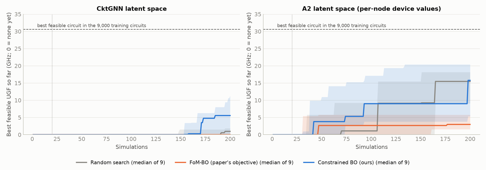
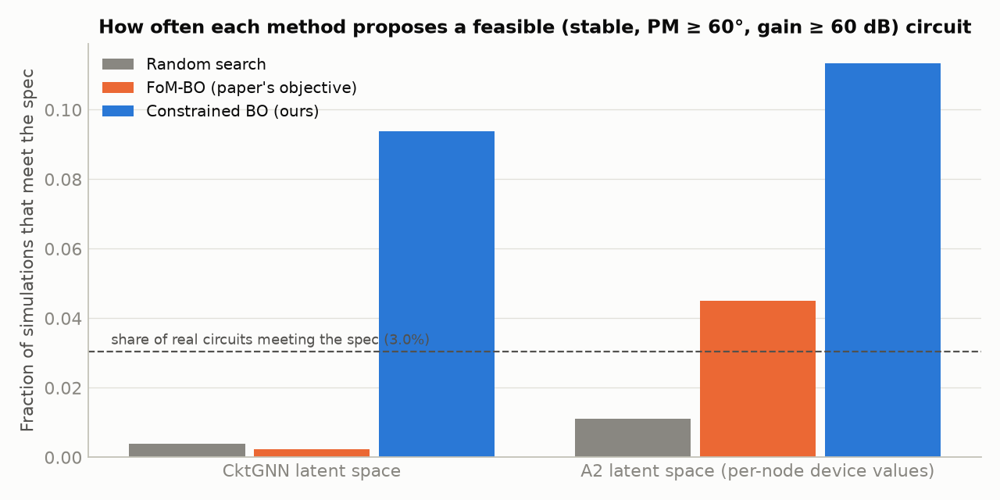

# CktGNN replication — Phase 4: stability-aware circuit optimisation

**Date:** 2026-10-14. **Question:** CktGNN's paper optimises its "FoM" in the learned latent space with Bayesian optimisation and reports the best circuits found. Does optimising that FoM produce op-amps that actually work, i.e. are *stable*? Does an optimiser that treats stability as a constraint do better on the same simulation budget?

All protocol choices below were fixed **before** any optimisation run.

---

## 1. Headline findings

1. **The benchmark's circuits are mostly unstable.** [E] An exact pole-based check (new in this phase) shows that **63% of OCB circuits are unstable even in open loop**, because the generator chooses gain polarities and feedback paths at random. Only **10% are stable as a unity-gain buffer**, and only **3.0% meet a standard op-amp specification** (stable, phase margin ≥ 60°, DC gain ≥ 60 dB).
2. **Optimising the paper's FoM selects unstable circuits.** [E] In CktGNN's latent space, the circuit each FoM-BO run ranks best was **stable in 0 of 9 runs**. FoM-BO also proposed *fewer* stable circuits than random search (1.2% vs 2.4% of simulations). FoM ≈ 10 × bandwidth (Phase 1), so the objective rewards bandwidth whatever the stability.
3. **Constrained BO finds working circuits far more reliably.** [E] Across both latent spaces it found a feasible circuit in **16 of 18 runs**, against 12/18 for random search and 9/18 for FoM-BO. In CktGNN's space, 9.4% of its proposals meet the spec, against 0.2% for FoM-BO (higher in 7/9 runs, Wilcoxon p = 0.03).
4. **Its advantage in the *best* design is real in CktGNN's space but not significant in A2's.** Median best feasible bandwidth:
   - **CktGNN space:** 5.6 GHz (cBO) vs 1.0 (random) vs 0 (FoM-BO); p = 0.055 and 0.078 with 9 paired runs.
   - **A2 space:** 15.8 GHz (cBO) vs 15.5 (random); p = 0.50.

   Constrained BO behaves **bimodally**. In about a third of runs it finds a feasible basin and exploits it (24–39% of proposals feasible); in the rest it barely finds one.
5. **The latent space matters more than the optimiser.** Every method does better in A2's latent space, the ablation variant with per-node device values, than in CktGNN's. Random search reaches a median 15.5 GHz there vs 1.0 GHz in CktGNN's. This matches Phase 3: CktGNN's decoder generates the fewest stable circuits.
6. **No method beats the best feasible circuit already in the training data** (30.6 GHz) within 200 simulations. The best found was 29.8 GHz (one FoM-BO run in CktGNN's space) and 25.6 GHz (cBO). Most feasible circuits found by cBO are new topologies (81–100%).

---

## 2. Protocol (fixed before running)

| Item | Setting |
|---|---|
| Design problem | maximise UGF subject to: 0 dB crossing exists; open-loop stable; closed-loop stable as a unity-gain buffer; PM ≥ 60°; DC gain ≥ 60 dB |
| Stability check | Exact poles of the linear MNA model (`scripts/ocb_sim.stability`). Closed loop: V(in) = −k·V(out) with k = sign(A(0)), so the feedback is negative at DC. Validated on a hand-checked two-stage amplifier, and against the Nyquist/PM criterion on open-loop-stable circuits (98.4% agreement) |
| Search space | Latent space of a trained VAE: **CktGNN** (the paper's model) or **A2** (`SubgDVAEpos`, per-node device values). Run k uses the VAE from training seed ((k−1) mod 3) + 1 |
| Evaluation | Argmax decode of z → read as an OCB op-amp (own slots if consistent, otherwise the structural reading) → device values clipped to the dataset range → simulate |
| Budget | 200 simulations per run, the first 20 random from N(μ_train, σ_train), **shared by all methods within a run** (paired design) |
| Methods | **RS:** random latent samples. **FoM-BO:** GP (Matérn-5/2) + expected improvement on the OCB FoM, i.e. the paper's objective. **cBO:** GP on log10(UGF) of functional circuits × probability of feasibility from a GP on a constraint score (Gardner et al., ICML 2014); maximise P(feasible) until the first feasible point |
| Acquisition search | 3,000 candidates per step: 1,500 prior samples + 1,500 perturbations of the 5 best points |
| Runs | 9 per method per latent space (54 runs) |
| Tests | Wilcoxon signed-rank on paired runs (same initial design) |

---

## 3. Results

### Summary (9 runs each)
| Latent space | Method | Runs finding a feasible circuit | Median best feasible UGF (GHz) | Mean ± std | Simulations feasible (mean) | Simulations stable | Distinct feasible circuits / run | Best-FoM circuit stable |
|---|---|---:|---:|---:|---:|---:|---:|---:|
| CktGNN | Random search | 5/9 | 0.97 | 1.6 ± 2.1 | 0.4% | 2.4% | 0.8 | 0/9 |
| CktGNN | FoM-BO (paper) | 2/9 | 0.00 | 3.5 ± 9.9 | 0.2% | 1.2% | 0.4 | **0/9** |
| CktGNN | **Constrained BO** | **7/9** | **5.56** | 8.7 ± 10.0 | **9.4%** | 13.3% | **18.8** | 0/9 |
| A2 | Random search | 7/9 | 15.47 | 12.1 ± 7.9 | 1.1% | 4.2% | 2.2 | 0/9 |
| A2 | FoM-BO (paper) | 7/9 | 2.98 | 7.8 ± 10.5 | 4.5% | 14.2% | 9.0 | 2/9 |
| A2 | **Constrained BO** | **9/9** | **15.77** | 13.7 ± 8.8 | **11.3%** | 19.5% | **22.7** | 2/9 |

Reference: the 9,000 training circuits contain 277 feasible ones (3.1%), the best at 30.6 GHz.

### Paired tests (best feasible UGF after 200 simulations)
| Latent space | Comparison | Median | First better in | p (Wilcoxon) |
|---|---|---|---|---:|
| CktGNN | cBO vs FoM-BO | 5.56 vs 0.00 | 6 of 9 (1 tie) | 0.078 |
| CktGNN | cBO vs random | 5.56 vs 0.97 | 7 of 9 (1 tie) | 0.055 |
| CktGNN | cBO vs FoM-BO, *share of feasible proposals* | 1.0% vs 0.0% | 7 of 9 | **0.031** |
| A2 | cBO vs FoM-BO | 15.77 vs 2.98 | 6 of 9 | 0.164 |
| A2 | cBO vs random | 15.77 vs 15.47 | 6 of 9 | 0.496 |

### Figures

*Figure 1. Best feasible bandwidth found so far (median and interquartile range over 9 runs; 0 = none found yet). The dashed line is the best feasible circuit among the 9,000 training circuits.*


*Figure 2. Share of simulations that meet the spec (mean over runs). For constrained BO the per-run values are bimodal: about a third of runs exceed 20%, the rest stay near 1%.*

### Correction to Phase 3 (from the new stability check)
| Generated circuits (10,000 per model) | A1 | A2 | CktGNN | Real test circuits |
|---|---:|---:|---:|---:|
| Stable (pole check) | **6.0 ± 0.8%** | 4.4 ± 0.5% | 3.0 ± 0.2% | 11.6% |
| Meets the spec | **1.6 ± 0.3%** | 1.2 ± 0.2% | 0.6 ± 0.3% | 2.8% |

Each step towards CktGNN *lowers* stability (A1 → A2 p = 0.04; A2 → CktGNN p = 0.03). The Phase 3 report has been corrected.

---

## 4. Interpretation

- **For the paper's claims:** CktGNN's Bayesian optimisation maximises a FoM that is ~99% bandwidth and has no stability term. On this benchmark, FoM-optimal circuits are essentially never stable. The paper's best circuits ("competitive with human experts' designs", Table 2 / Fig. 8) were never checked for stability. Our evidence says they most likely would not work as op-amps.
- **For the method:** a simple constrained acquisition (EI × P(feasible)) fixes the most important failure. It proposes feasible circuits 20–50× more often than FoM-BO in CktGNN's space, and finds one in almost every run. It does not yet reliably find *better* circuits than random search in a good latent space. Its bimodality points to the usual weaknesses of a single global GP in 66 dimensions with very few feasible points.
- **For the representation:** what the decoder can generate limits everything. A latent space whose decoder rarely produces stable circuits (CktGNN) makes every optimiser struggle. Improving the generator (Phase 3) and the optimiser are complementary.

## 5. Limitations

- **Behavioural circuits only.** The circuits are linear behavioural models: no transistor-level effects, bias, power or process variation.
- **One specification.** It is a standard target (PM ≥ 60°, gain ≥ 60 dB) chosen before running; other specifications could rank methods differently.
- **Small study.** 9 runs per cell and a budget of 200 simulations. Several p-values sit between 0.05 and 0.1.
- **Simple optimisers.** Deterministic (argmax) decoding; an isotropic GP kernel; no trust region. Stronger constrained-BO variants (e.g. SCBO, Eriksson & Poloczek 2021) were not tried.
- **Our FoM reading.** The FoM uses our reading of Ocean's phase output (the wrapped phase at the UGF, Phase 1). Because FoM is ~99% bandwidth, this choice barely matters.
- **Notional budget.** Our simulator is fast (~1.6 ms per circuit); with SPICE the same budget would be expensive, which is the setting the comparison is meant for.

## 6. Next steps

1. **Trust-region constrained BO (SCBO-style)** to remove the bimodality, plus more runs (≥ 20) to settle the best-design comparison.
2. **A property-aware latent space** (joint VAE + predictor of gain/UGF/stability), so feasible circuits cluster and the GP has an easier job.
3. **Transistor-level check** of the best feasible designs with ngspice and an open PDK.

## 7. Reproduce

```bash
.venv/Scripts/python.exe scripts/latent_bo.py --model CktGNN --method cbo --seed 1
```
(methods `rs`, `fom_bo`, `cbo`; models `CktGNN`, `SubgDVAEpos`; seeds 1–9; or `bash scripts/run_bo_jobs.sh <jobfile>`), then
```bash
.venv/Scripts/python.exe scripts/plot_bo.py
```
