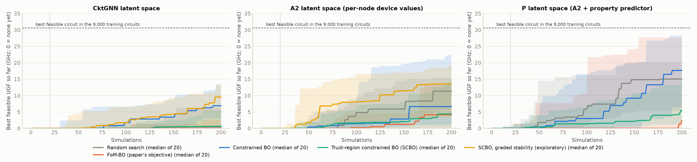
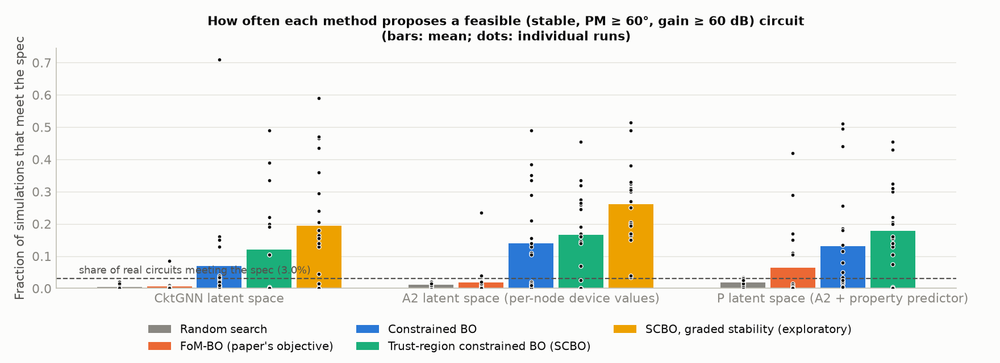

# CktGNN replication — Phase 5: separating the last ablation step, and trust-region constrained BO

**Date:** 2026-10-14. The protocol was fixed and committed before any run (`reports/phase5_protocol.md`, commit `edc9997`; one computational amendment before any result, `4393eb5`).

> **Replication note (Phase 7, 2026-10-15):** the optimisation results in Part B were re-run on 20 fresh seeds (`reports/phase7_report.md`).
> - **Replicate:** feasibility-rate results (constrained methods propose far more feasible circuits).
> - **Do not replicate:** the exploratory graded-SCBO advantage, and "cBO beats random search in CktGNN's space".
> - **Reverses:** "random search is as good as any optimiser in A2's space".
>
> With 20 runs, best-design comparisons in this setup are not reliable. Part A (A3) is unaffected.

Phase 5 closes two items left open by earlier phases:
- **Part A:** what in CktGNN's last design step causes its reconstruction gain and its unphysical device values (ablation A3).
- **Part B:** whether a trust-region constrained optimiser (SCBO) fixes constrained BO's bimodality and beats random search. Every comparison is re-run with 20 runs per cell instead of 9.

---

## Part A: ablation A3

Phase 3's last step, A2 → CktGNN, changed two things at once:
- **slot structure:** slots in the decoder's messages and edge scorer;
- **value pathway:** device values stored as one slot-indexed vector, encoded by an MLP and decoded once from z, instead of per node.

**A3** (`SubgDVAEslot`) is A2 plus CktGNN's exact slot structure. It has CktGNN's layer shapes and 2,510,767 parameters (CktGNN: 2.51M). Then A2 → A3 isolates the slot structure, and A3 → CktGNN isolates the value pathway. Same protocol as Phase 3: 3 seeds, 300 epochs, the paper's SGP regression, the authors' decoder metrics, and 10,000 simulated samples per run.

### A.1 Findings

1. **The value pathway alone explains CktGNN's reconstruction advantage.** [E] A3 reconstructs no better than A2 (0.181 vs 0.173, p = 0.70). CktGNN's value pathway then doubles it (0.181 → 0.379, p = 0.007).
2. **The value pathway alone explains CktGNN's unphysical device values.** [E] All device values are in range for 91.6% of A3's generated circuits, vs 93.1% for A2 (n.s.). The value pathway cuts this to 46.2% (p = 0.0001).
3. **Slot-aware structure decoding slightly improves the latent space and changes nothing else measurable.** [E] FoM/BW regression RMSE improves from 0.603 to 0.577 (p = 0.04), the best of all variants. Circuit-level metrics do not change: stable 4.4% → 4.5%, functional 77.6% → 73.9% (n.s.). The authors' valid-circuit rate dips from 98.9% to 97.0% (p = 0.047).
4. **The stability loss between A2 and CktGNN cannot be pinned to one step.** [E] Phase 3 found A2 → CktGNN lowers the stable share (4.4% → 3.0%, p = 0.03). Split in two, the drop falls almost entirely in the value-pathway step (4.5% → 3.0%), but with 3 seeds that step alone is not significant (p = 0.18).
5. **The value pathway also raises novelty.** [E] Functional novel circuits rise from 65.9% to 76.4% (p = 0.02), consistent with less accurate value decoding pushing samples away from the training set.

### A.2 Results (mean ± std over 3 seeds)

| Metric | A2 | **A3** | CktGNN | A2 → A3 (slot structure) | A3 → CktGNN (value pathway) |
|---|---:|---:|---:|---|---|
| SGP FoM RMSE ↓ | 0.603 ± 0.009 | **0.577 ± 0.001** | 0.631 ± 0.035 | −0.026 (p = 0.04) | +0.053 (p = 0.12) |
| SGP gain RMSE ↓ | 0.678 ± 0.011 | 0.673 ± 0.014 | 0.690 ± 0.008 | n.s. | n.s. |
| Topology reconstruction | 0.173 ± 0.031 | 0.181 ± 0.009 | **0.379 ± 0.034** | +0.008 (p = 0.70) | **+0.199 (p = 0.007)** |
| Valid circuits (authors' check) | 98.9% | 97.0% | 96.2% | −1.9 pt (p = 0.047) | n.s. |
| Generated: device values in range | 93.1 ± 1.3% | 91.6 ± 2.8% | **46.2 ± 3.3%** | n.s. | **−45 pt (p = 0.0001)** |
| Generated: functional | 77.6 ± 2.5% | 73.9 ± 3.5% | 79.5 ± 2.5% | n.s. | n.s. (p = 0.10) |
| Generated: stable (pole check) | 4.4 ± 0.5% | 4.5 ± 1.3% | 3.0 ± 0.2% | n.s. | −1.5 pt (p = 0.18) |
| Generated: meets spec | 1.2 ± 0.2% | 1.4 ± 0.6% | 0.6 ± 0.3% | n.s. | −0.8 pt (p = 0.14) |
| Generated: functional & novel | 69.7 ± 1.8% | 65.9 ± 3.8% | 76.4 ± 2.7% | n.s. | +10 pt (p = 0.02) |

Welch t-tests, 3 vs 3 seeds. Full table: `results/summary/ablation_table.md`; tests: `results/summary/ablation_tests.csv`.

### A.3 What this means

The complete decomposition of CktGNN's advantages over D-VAE (Phase 3 + A3):

| CktGNN component | What it does |
|---|---|
| Subgraph representation | Smoother latent space for BW/FoM (the paper's headline metric); worse for gain |
| Slot prior | More readable and functional generated circuits |
| Slot-aware messages and edge scorer | Slightly better latent regression; nothing else measurable |
| Slot-indexed value pathway | Doubles topology reconstruction; halves the share of physical device values |

The paper credits two-level message passing, which the released code does not contain. Its reconstruction numbers come from a design choice that removes per-node device values from the autoregressive decoder state. That choice makes topology easier to reconstruct and device values less physical. A plausible mechanism, not tested here: in A2 and A3, raw device values (1–101) enter every decoder step as inputs, while CktGNN's decoder state carries topology only.

---

## Part B: trust-region constrained BO (SCBO), 20 runs per cell

### B.1 Headline findings

1. **The pre-registered hypothesis is not supported.** [E] SCBO does not find better feasible circuits than constrained BO (cBO) or random search in either latent space.

   | Latent space | SCBO vs cBO | SCBO vs random search |
   |---|---|---|
   | CktGNN | 0.6 vs 6.9 GHz | 0.6 vs 0.5 GHz |
   | A2 | 4.4 vs 6.6 GHz | 4.4 vs 11.3 GHz |

   Values are medians of the best feasible UGF after 200 simulations. Every Holm-adjusted p is ≥ 0.49.

2. **SCBO is a good exploiter but a poor explorer.** [E]
   - It proposes feasible circuits most often: 12–17% of simulations, vs 0.5–1.2% for random search (p = 0.015 and 0.0008).
   - It finds the most distinct feasible circuits per run (24 and 33).
   - But it finds *any* feasible circuit in fewer runs than cBO: 11/20 vs 20/20 in CktGNN's space, 15/20 vs 18/20 in A2's.
   - It does not remove the bimodality: 4/20 and 8/20 runs exceed 20% feasible proposals, while most of the rest stay near zero.

3. **The failure has a clear cause: the constraint score is flat where SCBO needs a slope.** [E] In every run where SCBO never finds a feasible circuit, it proposes essentially **no stable circuits at all** after the initial design (0–4% stable, vs 34–38% in successful runs). Its trust region halves 13–15 times around an unstable centre.
   - Phase 4's constraint score gives every unstable circuit the same value (−60). "Least infeasible" therefore carries no information until something stable has been seen.
   - Only 2 of 20 initial designs per space contain a feasible circuit.
   - cBO escapes this because half of its candidates are global prior samples.
   - An exploratory variant with a graded stability score is in §B.5.

4. **With 20 runs, Phase 4's marginal cBO results become clear in CktGNN's space and vanish in A2's.** [E]
   - **CktGNN space:** cBO beats random search (median 6.9 vs 0.5 GHz, better in 13/20 runs, p = 0.014) and the paper's FoM-BO (6.9 vs 0.0, 17/20, p = 0.003). It finds a feasible circuit in 20/20 runs (random search 11/20, FoM-BO 7/20).
   - **A2 space:** random search is as good as any optimiser (median 11.3 GHz; cBO 6.6, p = 0.78) and finds a feasible circuit in 20/20 runs.
   - Phase 4's A2 medians (cBO 15.8, random search 15.5 GHz, 9 runs) moved by several GHz with 20 runs. Best-design medians at this sample size are noisy, so the larger sample matters.

5. **Optimising the paper's FoM still selects unstable circuits.** [E] The circuit each FoM-BO run ranks best is stable in 1/20 (CktGNN) and 0/20 (A2) runs. Constrained methods propose feasible circuits 10–20× more often (p = 0.002 and 0.003). Phase 4's main conclusion holds at n = 20.

6. **One constrained run matches the best known circuit.** [E] A cBO run in CktGNN's space found a new topology, not in the training set, at **31.0 GHz** (stable, PM 89°). That is 1.4% above the best feasible training circuit (30.6 GHz); re-simulating it independently reproduced every value. With behavioural models (its DC gain is 159 dB), this shows the latent space *can* reach the best known designs, not that it beats them.

### B.2 Results (20 runs per cell, 200 simulations each)

| Latent space | Method | Runs finding a feasible circuit | Median best feasible UGF (GHz) | Mean ± std | Simulations feasible | Simulations stable | Distinct feasible / run | Runs > 20% feasible | Best-FoM circuit stable |
|---|---|---:|---:|---:|---:|---:|---:|---:|---:|
| CktGNN | Random search | 11/20 | 0.46 | 4.0 ± 6.4 | 0.5% | 2.5% | 1.0 | 0 | 1/20 |
| CktGNN | FoM-BO (paper) | 7/20 | 0.00 | 2.6 ± 5.4 | 0.6% | 3.0% | 1.2 | 0 | 1/20 |
| CktGNN | cBO | **20/20** | **6.90** | 8.8 ± 7.8 | 6.9% | 13.4% | 13.8 | 1 | 1/20 |
| CktGNN | SCBO | 11/20 | 0.62 | 4.5 ± 7.1 | **12.1%** | **24.8%** | **23.8** | 4 | 0/20 |
| A2 | Random search | **20/20** | **11.32** | 10.6 ± 6.4 | 1.2% | 3.7% | 2.3 | 0 | 3/20 |
| A2 | FoM-BO (paper) | 13/20 | 4.13 | 7.4 ± 8.4 | 1.9% | 4.0% | 3.9 | 1 | 0/20 |
| A2 | cBO | 18/20 | 6.63 | 11.9 ± 12.1 | 13.9% | 21.2% | 27.8 | 6 | 6/20 |
| A2 | SCBO | 15/20 | 4.40 | 8.2 ± 9.0 | **16.6%** | **23.0%** | **33.1** | 8 | 3/20 |

Reference: 277 of the 9,000 training circuits (3.1%) meet the spec; the best is at 30.6 GHz.

### B.3 Tests (paired Wilcoxon signed-rank; pairs share the initial design)

| Latent space | Comparison | Metric | Medians | First better in | p | Holm p |
|---|---|---|---|---|---:|---:|
| CktGNN | **SCBO vs cBO** (primary) | best feasible UGF | 0.62 vs 6.90 | 7/20 | 0.12 | 0.49 |
| CktGNN | **SCBO vs random** (primary) | best feasible UGF | 0.62 vs 0.46 | 9/20 (3 ties) | 0.52 | 0.78 |
| A2 | **SCBO vs cBO** (primary) | best feasible UGF | 4.40 vs 6.63 | 7/20 | 0.26 | 0.78 |
| A2 | **SCBO vs random** (primary) | best feasible UGF | 4.40 vs 11.32 | 8/20 | 0.39 | 0.78 |
| CktGNN | cBO vs random | best feasible UGF | 6.90 vs 0.46 | 13/20 (2 ties) | **0.014** | – |
| CktGNN | cBO vs FoM-BO | best feasible UGF | 6.90 vs 0.00 | 17/20 (2 ties) | **0.003** | – |
| A2 | cBO vs random | best feasible UGF | 6.63 vs 11.32 | 8/20 | 0.78 | – |
| A2 | cBO vs FoM-BO | best feasible UGF | 6.63 vs 4.13 | 13/20 | 0.22 | – |
| CktGNN | SCBO vs random | share feasible | 5.5% vs 0.5% | 11/20 (3 ties) | **0.015** | – |
| A2 | SCBO vs random | share feasible | 16.5% vs 1.0% | 15/20 | **0.0008** | – |
| CktGNN | cBO vs FoM-BO | share feasible | 1.0% vs 0.0% | 17/20 | **0.002** | – |
| A2 | cBO vs FoM-BO | share feasible | 10.8% vs 0.8% | 15/20 | **0.003** | – |

All tests: `results/summary/bo5_tests.csv`. Summary table: `results/summary/bo5_table.md`.

### B.4 Figures


*Figure 1. Best feasible UGF found so far, as the median and interquartile range over 20 runs; 0 means none found yet. The dashed line is the best feasible training circuit. The third panel (P's latent space) belongs to Phase 6, and the yellow curve is the exploratory method of §B.5.*


*Figure 2. Share of simulations meeting the spec. Bars show the mean over runs, dots individual runs. Both constrained methods are bimodal: some runs settle in a feasible basin (20–70%), the others barely find one.*

### B.5 Exploratory: SCBO with a graded stability constraint

*Added after the results above, and labelled exploratory.* `scbo_g` changes one thing: unstable circuits score −60 − 60·(largest relative real part of a right-half-plane pole) instead of a flat −60, so the trust region can move towards stability. Everything else is plain SCBO: same 20 seeds, same initial designs.

| Latent space | Method | Runs finding a feasible circuit | Median best feasible UGF (GHz) | Simulations feasible | Simulations stable | Distinct feasible / run | Runs > 20% feasible |
|---|---|---:|---:|---:|---:|---:|---:|
| CktGNN | SCBO | 11/20 | 0.62 | 12.1% | 24.8% | 23.8 | 4 |
| CktGNN | **SCBO, graded** | 15/20 | **9.53** | **19.4%** | **35.8%** | **38.6** | 8 |
| A2 | SCBO | 15/20 | 4.40 | 16.6% | 23.0% | 33.1 | 8 |
| A2 | **SCBO, graded** | **20/20** | **13.54** | **26.2%** | **37.6%** | **52.1** | 13 |

Paired Wilcoxon tests, uncorrected:

| Latent space | Comparison | Medians | First better in | p |
|---|---|---|---|---:|
| CktGNN | graded vs plain SCBO | 9.53 vs 0.62 | 12/20 | 0.049 |
| A2 | graded vs plain SCBO | 13.54 vs 4.40 | 14/20 | 0.036 |
| CktGNN | graded SCBO vs cBO | 9.53 vs 6.90 | 9/20 | 0.90 |
| A2 | graded SCBO vs cBO | 13.54 vs 6.63 | 12/20 | 0.62 |
| A2 | graded SCBO vs random | 13.54 vs 11.32 | 11/20 | 0.37 |

**Reading:** the graded score repairs SCBO in both spaces, which is consistent with the diagnosis in finding 3:
- more runs find a feasible circuit;
- about 1.5× the feasible and stable proposals;
- the most distinct feasible circuits of any method.

It does not beat cBO or random search on the best design. These tests were chosen after seeing the data and are not corrected for multiplicity. Treat this as a hypothesis for a pre-registered follow-up, not a result.

### B.6 What this means

- **For the paper's claims:** the conclusion that FoM-optimal circuits are unstable now rests on 20 paired runs per cell.
- **For the method:** a better acquisition rule is not enough on its own. A local optimiser (SCBO) needs a constraint signal that ranks infeasible circuits. Our score gives none for unstable circuits, which are 63–90% of the space. Global constrained BO (cBO) is the more robust choice here, and the clear winner in a weak latent space (CktGNN's).
- **For the latent space:** in A2's space, plain random search already finds a feasible circuit in every run and is not beaten. The search space, not the optimiser, sets the ceiling. This motivates the property-aware latent space (Phase 6).

### B.7 Changes from Phase 4 and reproducibility

- **Seeding fix:** the method's random stream now uses a stable hash (`zlib.crc32`). Phase 4 used Python's `hash()`, which is salted per process, so its runs could not be re-run bit-for-bit. A re-run of `CktGNN cbo seed 3` reproduced its stored trace exactly. Phase 4's traces are kept unchanged in `<DATA>/results/bo/`.
- **SCBO computation:** GP hyperparameters are re-optimised every 5 steps (amendment `4393eb5`, made before any full SCBO run finished). Thompson samples use a Cholesky factor instead of sklearn's SVD-based `sample_y`; the samples have the same distribution, about 40× faster.
- **BLAS threads** are limited to one per job, so parallel jobs do not slow GPU training.

---

## Reproduce

```bash
PAR=3 OUT=D:/CktGNN_data/results/bo5 bash scripts/run_bo_jobs.sh JOBFILE
```
(`JOBFILE`: one `MODEL METHOD SEED` per line: `CktGNN`/`SubgDVAEpos` × `rs`/`fom_bo`/`cbo`/`scbo` × seeds 1–20), then:
```bash
.venv/Scripts/python.exe scripts/plot_bo.py --dir bo5
```
