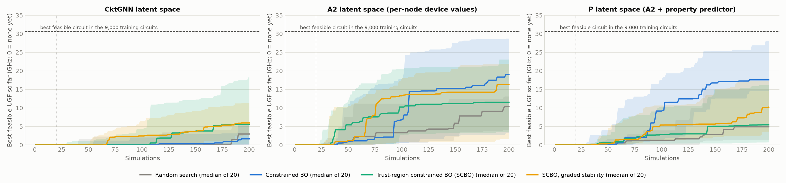
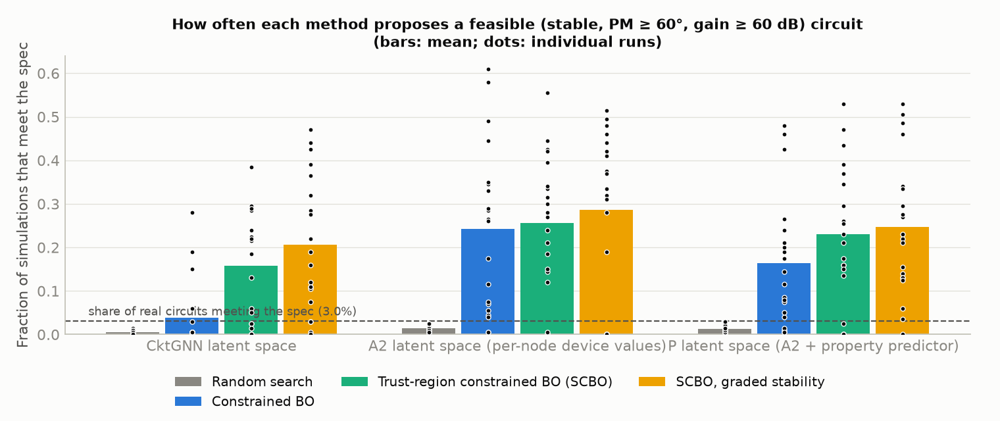

# CktGNN replication — Phase 7: confirmatory test of graded-stability SCBO, and how stable the optimisation results are

**Date:** 2026-10-15. The protocol was committed and pushed before any run (`reports/phase7_protocol.md`, commit `bf26ae4`). No optimisation code changed after Phase 5.

**Question:** in Phase 5, an exploratory SCBO variant with a graded stability score (`scbo_g`) beat plain SCBO in both latent spaces tested (p ≈ 0.04, uncorrected). Does this hold on **fresh runs**: new seeds (21–40), new initial designs, and all three latent spaces?

---

## 1. Headline findings

1. **The hypothesis is not confirmed.** [E] On fresh seeds, graded SCBO does not find better feasible circuits than plain SCBO in any latent space. Every Holm-adjusted p is 1.0.

   | Latent space | Median best feasible UGF, graded vs plain | Graded better in | p |
   |---|---|---:|---:|
   | CktGNN | 5.9 vs 5.6 GHz | 11/20 | 0.96 |
   | A2 | 16.3 vs 11.5 GHz | 10/20 | 0.94 |
   | P | 10.2 vs 5.4 GHz | 11/20 | 0.62 |

   The medians lean towards the graded variant, but pair by pair it wins only about half the time.

2. **The Phase 5 "win" was largely a poor draw for plain SCBO.** [E] On seeds 21–40, plain SCBO did much better than on seeds 1–20:
   - in CktGNN's space it found a feasible circuit in 17/20 runs (Phase 5: 11/20), with a median of 5.6 GHz (Phase 5: 0.6; p = 0.05 between seed sets);
   - the "SCBO never sees a stable circuit" failure from Phase 5 was much rarer.

   The graded score still produces the most stable proposals in CktGNN's and A2's spaces (34% and 42% of simulations, vs 27% and 35% for plain SCBO). That does not translate into better best designs.

3. **Best-design results from 20 runs are not reproducible across seed sets.** [E] This is the main lesson of this phase.
   - The *same* method in the *same* latent space gave significantly different results on two sets of 20 seeds: cBO in CktGNN's space, median 6.9 vs 1.6 GHz (p = 0.010); random search in P's space, 15.0 vs 4.9 GHz (p = 0.034).
   - Several earlier conclusions change on fresh seeds; see §3.

4. **Conclusions that hold on both seed sets.** [E]
   - Constrained methods (cBO, SCBO, graded SCBO) propose feasible circuits about 8–40× more often than random search, in every space and both seed sets. SCBO vs random search on the share of feasible proposals: paired p ≤ 0.0003 in every space.
   - cBO in P's latent space is the most consistent strong cell: median 17.6 GHz on both seed sets, 19/20 and 20/20 runs feasible.
   - Pooled over all 40 seeds (post hoc, descriptive), cBO beats random search in both CktGNN's space (3.4 vs 1.1 GHz, p = 0.041) and A2's (15.5 vs 10.7 GHz, p = 0.042).

---

## 2. Results (seeds 21–40, 200 simulations per run)

| Latent space | Method | Runs finding a feasible circuit | Median best feasible UGF (GHz) | Mean ± std | Simulations feasible | Simulations stable | Distinct feasible / run |
|---|---|---:|---:|---:|---:|---:|---:|
| CktGNN | Random search | 12/20 | 2.96 | 3.4 ± 4.2 | 0.5% | 2.3% | 1.0 |
| CktGNN | cBO | 14/20 | 1.65 | 4.6 ± 7.2 | 3.8% | 6.7% | 7.6 |
| CktGNN | SCBO | 17/20 | 5.57 | 10.5 ± 11.7 | 15.8% | 27.0% | 31.2 |
| CktGNN | SCBO, graded | **19/20** | **5.95** | 9.0 ± 8.7 | **20.6%** | **33.6%** | **40.1** |
| A2 | Random search | 19/20 | 10.42 | 9.2 ± 5.8 | 1.4% | 4.3% | 2.9 |
| A2 | cBO | **20/20** | **19.04** | **17.1 ± 11.9** | 24.2% | 33.1% | 48.4 |
| A2 | SCBO | 18/20 | 11.53 | 13.8 ± 11.1 | 25.7% | 34.6% | 50.6 |
| A2 | SCBO, graded | 15/20 | 16.28 | 14.2 ± 11.1 | **28.6%** | **42.4%** | **56.5** |
| P | Random search | 19/20 | 4.90 | 8.1 ± 7.9 | 1.3% | 4.2% | 2.6 |
| P | cBO | **20/20** | **17.57** | **19.1 ± 9.1** | 16.4% | 21.3% | 32.7 |
| P | SCBO | 17/20 | 5.44 | 9.7 ± 10.4 | 23.0% | 34.4% | 45.9 |
| P | SCBO, graded | 19/20 | 10.23 | 11.3 ± 9.0 | **24.6%** | 34.4% | **49.2** |

### Tests (paired Wilcoxon; pairs share the initial design)
| Latent space | Comparison | Medians (GHz) | First better in | p | Holm p |
|---|---|---|---:|---:|---:|
| CktGNN | **graded vs plain SCBO** (primary) | 5.95 vs 5.57 | 11/20 | 0.96 | 1.0 |
| A2 | **graded vs plain SCBO** (primary) | 16.28 vs 11.53 | 10/20 | 0.94 | 1.0 |
| P | **graded vs plain SCBO** (primary) | 10.23 vs 5.44 | 11/20 | 0.62 | 1.0 |
| CktGNN | graded SCBO vs cBO | 5.95 vs 1.65 | 15/20 | 0.027 | – |
| CktGNN | graded SCBO vs random | 5.95 vs 2.96 | 14/20 | 0.010 | – |
| A2 | cBO vs random | 19.04 vs 10.42 | 14/20 | 0.014 | – |
| P | cBO vs random | 17.57 vs 4.90 | 16/20 | 0.001 | – |
| P | cBO vs graded SCBO | 17.57 vs 10.23 | 15/20 | 0.005 | – |

All tests: `results/summary/bo7_tests.csv`; table: `results/summary/bo7_table.md`. Secondary tests are uncorrected.


*Figure 1. Best feasible UGF found so far, as the median and interquartile range over 20 fresh runs per method. The bands overlap almost everywhere.*


*Figure 2. Share of simulations meeting the spec; bars show the mean, dots individual runs.*

---

## 3. Replication check: seeds 1–20 (Phases 5–6) vs seeds 21–40 (Phase 7)

*Post hoc and descriptive. The two seed sets use the same code, the same trained VAEs (cycled the same way) and the same budget; only the initial designs and random streams differ.*

| Latent space | Method | Median, seeds 1–20 | Median, seeds 21–40 | Runs feasible | p (Mann–Whitney) |
|---|---|---:|---:|---|---:|
| CktGNN | Random search | 0.46 | 2.96 | 11 → 12 | 0.79 |
| CktGNN | cBO | 6.90 | 1.65 | 20 → 14 | **0.010** |
| CktGNN | SCBO | 0.62 | 5.57 | 11 → 17 | 0.052 |
| CktGNN | SCBO, graded | 9.53 | 5.95 | 15 → 19 | 0.81 |
| A2 | Random search | 11.32 | 10.42 | 20 → 19 | 0.43 |
| A2 | cBO | 6.63 | 19.04 | 18 → 20 | 0.13 |
| A2 | SCBO | 4.40 | 11.53 | 15 → 18 | 0.10 |
| A2 | SCBO, graded | 13.54 | 16.28 | 20 → 15 | 0.80 |
| P | Random search | 15.03 | 4.90 | 20 → 19 | **0.034** |
| P | cBO | 17.64 | 17.57 | 19 → 20 | 0.76 |
| P | SCBO | 5.41 | 5.44 | 17 → 17 | 0.96 |

**How earlier conclusions fare on fresh seeds:**

| Earlier conclusion | Seeds 21–40 | Status |
|---|---|---|
| Phase 5: cBO beats random search in CktGNN's space (p = 0.014) | 1.65 vs 2.96, p = 0.84 | **does not replicate**; holds pooled over 40 seeds (p = 0.041) |
| Phase 5: in A2's space random search is as good as any optimiser | cBO beats random search, p = 0.014 | **reverses**; cBO better pooled (p = 0.042) |
| Phase 5: SCBO is no better than cBO on the best design | SCBO vs cBO: better in CktGNN's space (p = 0.04), worse in P's (p = 0.007) | **mixed** |
| Phase 5 (exploratory): graded SCBO beats plain SCBO | p = 0.62–0.96 | **does not replicate** |
| Phase 6: cBO finds better designs in P's space than in A2's (17.6 vs 6.6 GHz, n.s.) | 17.6 vs 19.0 GHz | **does not replicate**; the direction reverses |
| Phases 4–6: constrained methods propose far more feasible circuits than random search or FoM-BO | 8–40× more than random search; SCBO vs random p ≤ 0.0003 | **replicates** |
| Phase 6: P's latent space is far more predictive (SGP) | not re-tested (model property, not seed-dependent) | – |

---

## 4. Interpretation

- **For the method:** the graded score does what it was designed to do: more stable and more feasible proposals, and the most distinct feasible circuits. It does not improve the *best* design found in 200 simulations. The Phase 5 diagnosis (a flat constraint score makes SCBO fail) described a real failure mode, but one that occurs on only some seeds.
- **For the project:** best-design endpoints in this setup have very high variance. Standard deviations of 4–12 GHz sit around medians of 2–19 GHz, and 20 paired runs cannot reliably separate methods whose medians differ by a few GHz. Any claim about which optimiser finds better *best* circuits needs at least 40 runs per cell, or a lower-variance endpoint such as:
  - the area under the best-so-far curve;
  - the share of feasible proposals;
  - the time to first feasible circuit.

  Feasibility-rate conclusions are robust; best-design conclusions are not.
- **For the paper:** CktGNN's paper reports BO results from 10 runs with a single best-FoM number. These results show that best-design comparisons at that sample size can flip between seed sets. Its optimisation claims are therefore weaker evidence than its error bars suggest (see also Phase 2's finding that the paper's error bars are 5–20× too small).

## 5. Reproduce

```bash
PAR=6 OUT=D:/CktGNN_data/results/bo7 bash scripts/run_bo_jobs.sh JOBFILE
```
(`JOBFILE`: `CktGNN`/`SubgDVAEpos`/`SubgDVAEprop` × `scbo_g`/`scbo`/`cbo`/`rs` × seeds 21–40), then:
```bash
.venv/Scripts/python.exe scripts/plot_bo.py --dir bo7
```
