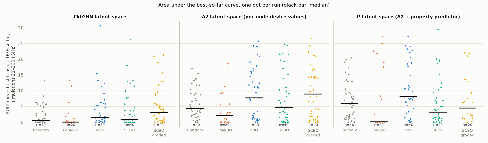
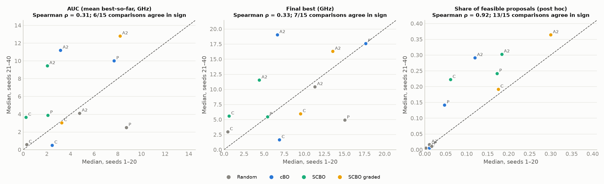

# CktGNN replication — Phase 8: an area-under-the-curve endpoint, and which optimisation results are reliable

**Date:** 2026-10-15. The protocol and analysis script were committed and pushed before the script was run (`reports/phase8_protocol.md`, `scripts/bo_auc.py`, commit `640db7e`).

**Data status:** existing runs only, 40 seeds per cell (seeds 1–20 from Phases 5–6, seeds 21–40 from Phase 7). The final-best results and median convergence curves had already been seen, so this is a **pre-specified analysis of partly unblinded data**. The AUC values and the reliability check had not been computed before the protocol was committed.

**Question:** Phase 7 showed that the best design found after 200 simulations is unreliable at 20 runs per cell. Is an area-under-the-curve (AUC) endpoint more reliable? And what do 40 paired runs say about the optimisers?

---

## 1. Headline findings

1. **AUC is not more reliable than the final best. The pre-stated expectation was wrong, so AUC is not adopted.** [E] Agreement between seeds 1–20 and seeds 21–40:

   | Measure | AUC | Final best |
   |---|---:|---:|
   | Spearman correlation of the 11 cell medians | 0.31 | 0.33 |
   | Method comparisons with the same sign in both sets | 6/15 | 7/15 |
   | Cells whose distribution shifts significantly between sets | 4/11 | 2/11 |

   For both endpoints, a 20-run comparison of two optimisers agrees in direction with an independent 20-run replication **about as often as a coin flip**.

2. **How *often* a method proposes feasible circuits is a reliable property; how *good* its best circuit is, is not.** [E, post hoc] The same check on the share of feasible proposals (simulations 21–200) gives:
   - Spearman ρ = **0.92**;
   - **13/15** comparisons with the same sign, including 7/8 comparisons against random search.

   This endpoint was not pre-specified. It is reported as a contrast, and it supports the claim made in Phases 4–7 that feasibility-rate conclusions replicate. One caveat from the figure: the *level* of feasibility still shifts between seed sets (seeds 21–40 are higher for every constrained method), but the *ordering* of methods holds.

3. **With 40 paired runs, almost no best-design difference between optimisers survives correction.** [E] Of the 6 pre-specified AUC comparisons, one is significant after Holm correction: **cBO beats SCBO in P's latent space** (AUC median 8.1 vs 3.2 GHz, better in 28/40 runs, p = 0.007, Holm p = 0.044). cBO vs random search points the same way in all three spaces, but none survives correction (Holm p = 0.27–0.35).

4. **Uncorrected secondary results, for orientation only:**
   - Graded SCBO has the largest AUC margin over random search: CktGNN space 3.0 vs 0.5 GHz (p = 0.005); A2 space 8.9 vs 4.3 GHz (p = 0.013).
   - On the final-best endpoint over 40 seeds, cBO beats random search in all three spaces (p = 0.041, 0.042, 0.002) and beats SCBO in A2's and P's spaces (p = 0.041, 0.0008).
   - P vs A2 on AUC: no difference for any method (p ≥ 0.40).

---

## 2. Results

### AUC by cell (simulations 21–200; GHz)
| Latent space | Method | Runs | Median AUC | Mean ± std | Median final best | Runs finding a feasible circuit | Median first feasible |
|---|---|---:|---:|---:|---:|---:|---:|
| CktGNN | Random search | 40 | 0.45 | 2.0 ± 3.0 | 1.13 | 23/40 | 169 |
| CktGNN | FoM-BO | 20 | 0.00 | 1.9 ± 3.9 | 0.00 | 7/20 | none (201) |
| CktGNN | cBO | 40 | 1.45 | 3.9 ± 6.0 | 3.44 | 34/40 | 99 |
| CktGNN | SCBO | 40 | 0.83 | 3.9 ± 5.9 | 2.41 | 28/40 | 113 |
| CktGNN | SCBO, graded | 40 | **3.03** | **5.1 ± 6.1** | **6.56** | 34/40 | **65** |
| A2 | Random search | 40 | 4.31 | 5.9 ± 4.8 | 10.71 | 39/40 | 53 |
| A2 | FoM-BO | 20 | 2.16 | 3.8 ± 4.9 | 4.13 | 13/20 | 105 |
| A2 | cBO | 40 | 7.67 | 8.9 ± 8.3 | **15.50** | 38/40 | 45 |
| A2 | SCBO | 40 | 4.65 | 7.6 ± 8.1 | 8.01 | 33/40 | 38 |
| A2 | SCBO, graded | 40 | **8.94** | **9.5 ± 7.9** | 14.66 | 35/40 | **36** |
| P | Random search | 40 | 6.04 | 7.0 ± 6.1 | 9.57 | 39/40 | 44 |
| P | FoM-BO | 20 | 0.10 | 7.6 ± 10.3 | 2.38 | 12/20 | 122 |
| P | cBO | 40 | **8.09** | **10.3 ± 7.8** | **17.57** | 39/40 | 48 |
| P | SCBO | 40 | 3.16 | 5.9 ± 7.3 | 5.44 | 34/40 | **37** |
| P | SCBO, graded | 20 | 4.46 | 7.1 ± 7.4 | 10.23 | 19/20 | 38 |

Standard deviations are about as large as the means in every cell, so AUC has the same dispersion problem as the final best.

### Primary tests (AUC, paired Wilcoxon over 40 seeds, Holm across 6)
| Latent space | Comparison | Median AUC | First better in | p | Holm p |
|---|---|---|---:|---:|---:|
| CktGNN | cBO vs random | 1.45 vs 0.45 | 21/40 (4 ties) | 0.087 | 0.35 |
| A2 | cBO vs random | 7.67 vs 4.31 | 22/40 | 0.10 | 0.35 |
| P | cBO vs random | 8.09 vs 6.04 | 26/40 | 0.055 | 0.27 |
| CktGNN | SCBO vs cBO | 0.83 vs 1.45 | 24/40 | 0.42 | 0.42 |
| A2 | SCBO vs cBO | 4.65 vs 7.67 | 16/40 | 0.18 | 0.37 |
| P | **SCBO vs cBO** | 3.16 vs **8.09** | 12/40 | **0.007** | **0.044** |

All tests (including time to first feasible, final best, graded SCBO and P vs A2): `results/summary/bo_auc_tests.csv`. Reliability details: `bo_auc_reliability.csv`, `bo_auc_sign_agreement.csv`.


*Figure 1. AUC of every run; the black bar is the median. In every cell the runs spread from 0 to well above the median.*


*Figure 2. Cell medians on seeds 1–20 (x) vs seeds 21–40 (y); the dashed line marks perfect agreement. AUC (left) and final best (middle) scatter widely. The share of feasible proposals (right, post hoc) preserves the ordering of methods, but shifts upward on seeds 21–40.*

---

## 3. What the optimisation study can and cannot claim (Phases 4–8 together)

| Claim | Status | Evidence |
|---|---|---|
| Optimising the paper's FoM selects unstable circuits | **Robust** | The circuit each FoM-BO run ranks best is stable in at most 2 of 20 runs per space (Phases 5–6) and 2 of 9 (Phase 4) |
| Constrained methods propose far more feasible circuits than random search or FoM-BO | **Robust** | About 7–40× more than random search in every space and both seed sets; cross-set ranking ρ = 0.92 |
| cBO finds better best designs than random search | **Suggestive** | Same direction in all 3 spaces on 40 seeds; significant on final best (uncorrected), not on AUC after correction |
| cBO beats SCBO | **Supported in P's space only** | AUC Holm p = 0.044; mixed elsewhere |
| Graded SCBO beats plain SCBO | **Not supported** | Phase 7 confirmatory test: Holm p = 1.0 |
| Property-aware latent space (P) improves optimisation | **Not supported** | Phase 7 reversal; AUC P vs A2 p ≥ 0.40 |
| Comparisons from 20 runs or fewer of best-design endpoints (final or AUC) | **Unreliable** | Sign agreement 6–7/15 between independent seed sets |

**For the paper:** CktGNN reports BO results from 10 runs as single best-FoM values. Our data show that best-design comparisons at that sample size do not replicate. Its optimisation results, like ours at 20 runs, should be treated as anecdotal.

**For future work:**
- Feasibility rate, or a similar per-proposal quality measure, is a much better primary endpoint for comparing optimisers here.
- Best-design claims need many more runs than 40, a much larger budget per run, or a variance-reduction design, such as more simulations per run so the best-so-far curves converge.

---

## 4. Reproduce

```bash
.venv/Scripts/python.exe scripts/bo_auc.py
```
(reads `<DATA>/results/bo5` and `<DATA>/results/bo7`; see Phases 5–7 for generating them)
