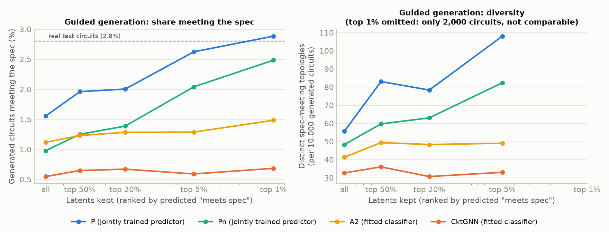

# CktGNN replication — Phase 9: improving the generative model

**Date:** 2026-10-15. The protocol was committed and pushed before any Phase 9 computation (`reports/phase9_protocol.md`, commit `ec43ddb`).

**Goal:** improve what the generative model produces. Over 10,000 prior samples, the best model so far (P) generated:

| Generated circuits | P | Real test circuits |
|---|---:|---:|
| Stable | 4.6% | 11.6% |
| Meets spec (stable, PM ≥ 60°, gain ≥ 60 dB) | 1.7% | 2.8% |
| Device values in range | 82% | 100% |

Its topology reconstruction was 0.24, against CktGNN's 0.38. Two changes were tested. **In short:** predictor-guided generation works (Part A, confirmed). Normalised value inputs trade latent quality and stability for reconstruction and physical values (Part B, primary endpoints not significant).

The two changes:
- **Part A:** use P's jointly trained predictor to choose *which* latent points to decode. No training.
- **Part B:** retrain P with normalised device-value inputs (Pn).

---

## Part A: predictor-guided generation

**Design** (per seed, 3 seeds):
1. Draw 20,000 latents from the prior and rank them by predicted "meets spec".
2. **Guided arm:** decode the top 5% (1,000 latents × 10 decodes).
3. **Control arm:** decode 1,000 latents drawn at random from the same pool, the same way.
4. Simulate all 20,000 circuits.

A2 and CktGNN have no predictor, so they use a logistic regression fitted afterwards on their training latents.

### A.1 Findings

1. **Confirmed for P.** [E] Guided generation produces spec-meeting circuits **1.6× as often**: 2.62% vs 1.62% of generated circuits.
   - Guided is better in all 3 seeds.
   - Bootstrap 95% CI of the difference: +0.45 to +1.56 percentage points. Both pre-registered conditions hold.
   - Guided P reaches the real-data rate (2.8%) at the top 1%.
2. **It increases diversity rather than collapsing it.** [E] Guided P yields 108 distinct spec-meeting topologies per 10,000 circuits vs 64 for the control (+68%). Its stable share rises from 4.7% to 6.8%. The costs are small: functional share falls from 74.6% to 70.8%, and novelty is unchanged (64% vs 66%).
3. **The effect grows with selectivity.** [E] Meets-spec share by fraction of the pool kept:

   | Kept | Meets spec |
   |---|---:|
   | All | 1.55% |
   | Top 50% | 1.96% |
   | Top 20% | 2.00% |
   | Top 5% | 2.62% |
   | Top 1% | 2.88% |

4. **A classifier fitted afterwards does not work.** [E] With a logistic regression fitted on their latents, guidance changes nothing for A2 (1.29% vs 1.38%, CI −0.54 to +0.37 pt) or CktGNN (0.65% vs 0.71%, CI −0.34 to +0.20 pt). Training the predictor jointly is what makes the latent space steerable.

   **Confound:** P's predictor is also non-linear (an MLP), while the fitted classifiers are linear. The comparison shows that "a jointly trained MLP works and a linear classifier fitted afterwards does not". It does not isolate joint training on its own.

### A.2 Results (mean over 3 seeds; 10,000 circuits per arm and seed)

| Model (predictor) | Arm | Meets spec | Stable | Functional | Values in range | Novel | Distinct spec topologies |
|---|---|---:|---:|---:|---:|---:|---:|
| P (joint MLP) | control | 1.62% | 4.7% | 74.6% | 82.0% | 65.7% | 64 |
| P (joint MLP) | **guided** | **2.62%** | **6.8%** | 70.8% | 81.2% | 63.6% | **108** |
| A2 (fitted logistic) | control | 1.38% | 4.4% | 77.2% | 92.8% | 68.9% | 48 |
| A2 (fitted logistic) | guided | 1.29% | 4.4% | 77.0% | 94.1% | 67.2% | 49 |
| CktGNN (fitted logistic) | control | 0.71% | 2.6% | 79.8% | 46.4% | 76.7% | 38 |
| CktGNN (fitted logistic) | guided | 0.65% | 3.0% | 77.5% | 46.5% | 74.0% | 37 |


*Figure 1. Share of generated circuits meeting the spec (left) and distinct spec-meeting topologies (right), against how selectively the latents are chosen. P (blue) and Pn (green) improve with selectivity; the fitted classifiers do not help A2 or CktGNN. The top-1% point is omitted from the diversity panel because it rests on only 2,000 circuits.*

Data: `results/summary/guided_generation.csv`, `guided_dose_response.csv`, and per run `results/vae/<run>/guided_generation.json` and `guided_latents.csv`.

---

## Part B: normalised device-value inputs (Pn)

**Pn** (`SubgDVAEpropn`) is P with one change. Device values enter the GRUs as (v − 51) / 29.2 instead of raw integers 1–101; the value head and its loss are unchanged. Same protocol as P: 3 seeds, 300 epochs.

### B.1 Findings

1. **Neither primary endpoint is significant at α = 0.05, although both move strongly in the predicted direction.** [E]
   - Topology reconstruction: 0.239 → **0.322** (p = 0.11). One seed reached 0.385, CktGNN's level.
   - Generated circuits with all device values in range: 81.7% → **95.3%** (p = 0.050, just above the threshold).

   With 3 seeds the evidence is suggestive, not confirmatory.
2. **Pn generates more functional, more novel circuits with physical device values.** [E] Functional 74.7% → 81.3% (n.s.); novel 66.2% → 76.5% (n.s.); own slots consistent with the structure 51.3% → 66.8% (p = 0.047).
3. **But it gives up latent-space quality and, probably, stability.** [E]
   - FoM/BW regression from the latents is worse: RMSE 0.475 → 0.516, p = 0.007. This is the only significant change.
   - The predictor is slightly weaker (meets-spec AUC 0.943 → 0.931).
   - Generated circuits are less often stable (4.6% → 3.2%, p = 0.14) and less often meet the spec (1.7% → 1.2%, p = 0.20).
4. **Guided generation works for Pn too.** [E] Spec-meeting share 1.34% → 2.04% (1.5×), better in all 3 seeds, CI +0.22 to +1.18 pt. Guided Pn still stays below guided P (2.62%).

### B.2 Results (mean ± std, 3 seeds; Welch t-test)

| Metric | P | **Pn** | p |
|---|---:|---:|---:|
| **Topology reconstruction** (primary) | 0.239 ± 0.020 | **0.322 ± 0.055** | 0.11 |
| **Generated: device values in range** (primary) | 81.7 ± 5.6% | **95.3 ± 0.5%** | 0.050 |
| SGP FoM RMSE ↓ | **0.475 ± 0.007** | 0.516 ± 0.010 | 0.007 |
| SGP gain RMSE ↓ | 0.298 ± 0.008 | 0.280 ± 0.009 | 0.07 |
| Predictor AUC, meets spec | 0.943 | 0.931 | – |
| Valid circuits (authors' check) | 97.6% | 96.4% | 0.51 |
| Novel (authors' check) | 91.3% | **95.5%** | 0.009 |
| Generated: functional | 74.7% | 81.3% | 0.26 |
| Generated: stable | **4.6%** | 3.2% | 0.14 |
| Generated: meets spec | **1.7%** | 1.2% | 0.20 |
| Generated: own slots consistent | 51.3% | **66.8%** | 0.047 |
| Guided generation: meets spec (top 5%) | **2.62%** | 2.04% | – |

Full tables: `results/summary/ablation_table.md` and `ablation_tests.csv` (step "normalised value inputs (Phase 9)").

---

## What this means

- **The best way found here to get more working circuits from the model is to select latents with the jointly trained predictor**: P with guided generation. It needs no retraining, raises the spec-meeting share 1.6× to roughly the real-data rate, and increases the variety of working designs. It only works with a predictor trained into the latent space; a linear classifier fitted afterwards does nothing.
- **Normalising device-value inputs is a trade-off, not a free improvement.** It moves reconstruction towards CktGNN's level and makes device values physical, as the Phase 5 mechanism predicted, but costs latent predictiveness and probably stability. Which model to use depends on the goal:
  - **P + guided generation** for circuits that meet a stability spec;
  - **Pn** for accurate reconstruction and physical device values.
- **Still far from the real data on stability:** even guided P generates stable circuits at 6.8%, against 11.6% for real circuits. Possible next steps:
  - stronger predictor weight or a stability-weighted loss;
  - predictor-guided optimisation, i.e. using the predictor inside BO;
  - more seeds for Pn to settle its primary endpoints.

## Reproduce

Part A, for each model in P (`SubgDVAEprop`), Pn (`SubgDVAEpropn`), A2 (`SubgDVAEpos`) and `CktGNN`, and each seed 1–3:
```bash
.venv/Scripts/python.exe scripts/guided_generation.py --model SubgDVAEprop --seed 1
```
then:
```bash
.venv/Scripts/python.exe scripts/guided_analysis.py --models SubgDVAEprop SubgDVAEpropn SubgDVAEpos CktGNN
```
Part B (training; or use the released checkpoints):
```bash
DEVICE=cuda bash scripts/launch_job.sh SubgDVAEpropn 1 --epochs 300 --patience 10
```
(seeds 1–3), then `sgp_regression.py` and `eval_circuits.py --model SubgDVAEpropn` for each run, then `aggregate_results.py` and `plot_ablation.py`.
